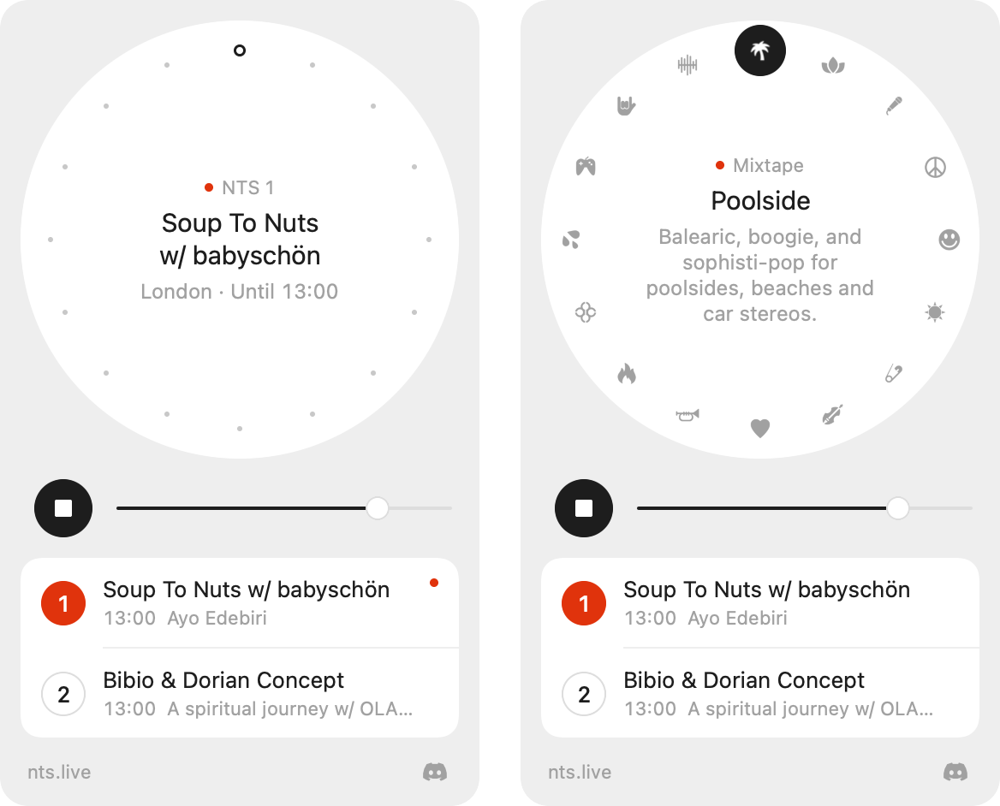

# Tuner

A small macOS menu bar player for NTS Radio, designed after Dieter Rams.



The dial has the sixteen Infinite Mixtapes on it, and NTS 1 and NTS 2 sit in the list underneath with what's on now and what's on next. Point at the dial and the dots turn into each mixtape's icon. The middle of the dial shows the show that's on, where it's broadcasting from and when it finishes, straight from NTS's live schedule.

If you work at NTS and want to use any of this, please do. The code is MIT licensed, so you can take it, change it and ship it without asking.

## Controls

- Drag the bead, click a dot or scroll over the dial to pick a mixtape. On a Force Touch trackpad you feel a tick at each one.
- The arrow keys step through the mixtapes.
- Space, or clicking the middle of the dial, plays or stops.
- Clicking NTS 1 or NTS 2 in the list plays it, and clicking again stops it.
- Media keys work, and whatever's playing shows up in Now Playing, with the show's artwork on NTS 1 and 2.
- ⌘Q, or right-click anywhere in the panel, quits.

## Build

Needs macOS 14 or later, Xcode and [XcodeGen](https://github.com/yonaskolb/XcodeGen).

```sh
brew install xcodegen
xcodegen generate
xcodebuild -project Tuner.xcodeproj -scheme Tuner -configuration Release -derivedDataPath build build
open build/Build/Products/Release/Tuner.app
```

It's signed ad hoc, so a build only runs on the Mac that made it. To hand it to other people it needs signing with a Developer ID and notarising.

## How it works

### The API

The NTS website gets its data from a few JSON endpoints that anyone can call without a key.

- `https://www.nts.live/api/v2/live` returns both live channels, each with the show that's on now and the next seventeen. `broadcast_title` is in capitals, so Tuner uses `embeds.details.name`, which keeps the show's own casing. When NTS has no details for a broadcast, `embeds` comes back as an empty array instead of an object, so the decoder in `NTS.swift` accepts either.
- `https://www.nts.live/api/v2/mixtapes` lists the Infinite Mixtapes with their descriptions, icons and stream URLs. The list in `Station.swift` and the icons in the asset catalog came from here.

Tuner refreshes the schedule once a minute, or four seconds after the current show is due to end if that's sooner.

### Streams

Every channel is available two ways. The Icecast stream (`https://stream-relay-geo.ntslive.net/stream` for NTS 1, which redirects to Radiomast) is one long HTTP response, so a player can start as soon as a little audio arrives. The HLS stream the NTS website plays (`https://streams.radiomast.io/nts1/hls.m3u8`) is a playlist of short audio files.

I recorded both at the same time for 110 seconds and lined the recordings up. The HLS feed was 40.9 seconds behind on NTS 1 and 38.1 seconds behind on Poolside, so Tuner uses Icecast and is about 40 seconds closer to live than the website.

AVPlayer took about 3.4 seconds to make a sound on the Icecast streams with its default buffering. Setting `preferredForwardBufferDuration` to 1 second for the start got that to about 0.7 seconds, and `Radio.swift` sets it back to the default once the audio is playing so a bad connection is less likely to cut out.

## Files

- `Station.swift` has the station list and stream URLs, in dial order.
- `NTS.swift` decodes the live schedule.
- `Radio.swift` handles playback, reconnecting, media keys, Now Playing and the schedule refresh.
- `Dial.swift` is the mixtape dial. `Panel.swift` is everything around it.
- `MenuBarIcon.swift` draws the dial again at menu bar size, or the channel number while NTS 1 or 2 is on.
- `Theme.swift` has the colours, sizes and animation curves.

## Development

Debug builds take two flags. `--snapshot <folder>` renders the panel offscreen with today's real schedule and quits, without opening any windows. The app is sandboxed, so the folder needs to be inside its container:

```sh
build/Build/Products/Debug/Tuner.app/Contents/MacOS/Tuner --snapshot ~/Library/Containers/com.joeparkerrees.tuner/Data/tmp/snap
```

`--selftest` plays NTS 1 muted, retunes through a few stations and quits, printing the state after each step. It's the quickest way to check playback and the Now Playing callbacks after a change. It uses its own settings, so it won't touch your volume or station.

## Credits

- The code is MIT licensed, see [LICENSE](LICENSE).
- NTS Radio, the station names, the mixtape descriptions and the mixtape icons in `Tuner/Assets.xcassets` belong to NTS. The streams and schedule come from NTS's own public endpoints. Tuner is an independent project and isn't affiliated with NTS.
- The Discord logo is from [Simple Icons](https://simpleicons.org) (CC0). Discord and its logo are trademarks of Discord Inc.
- The accent red was sampled from a button on Dieter Rams's T 1000 radio for Braun.
- Thanks to [NTS Dial](https://github.com/sennabecool/nts-dial) by sennabecool, which got me started, and the [Atonemo NTS Radio Player](https://shop.nts.live/products/atonemo-nts-radio-player).
